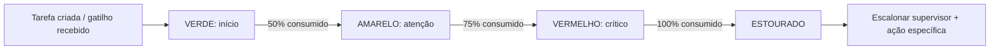
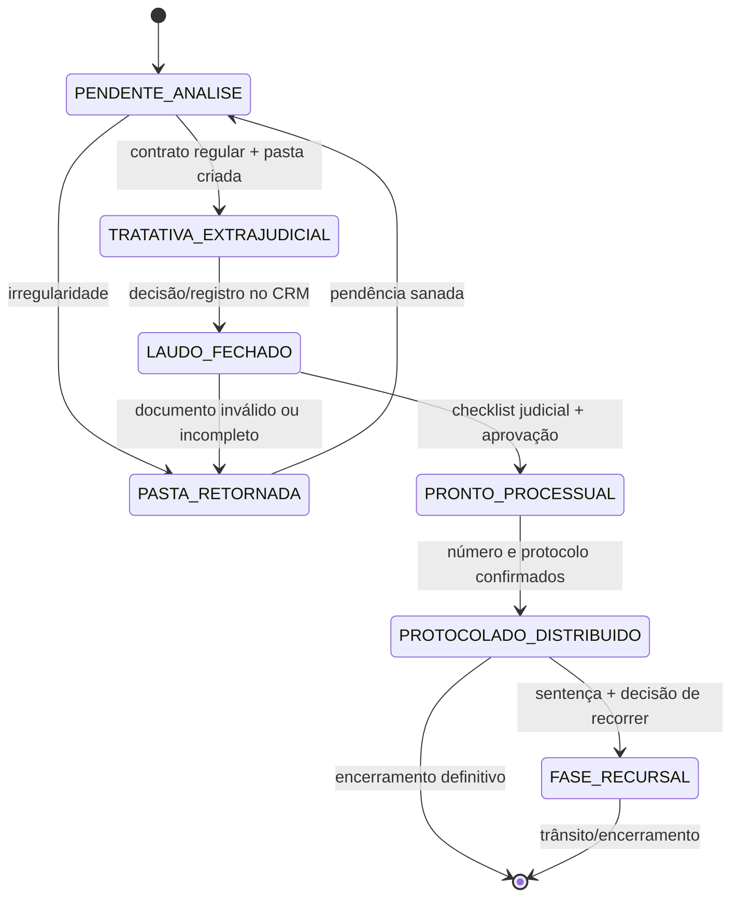
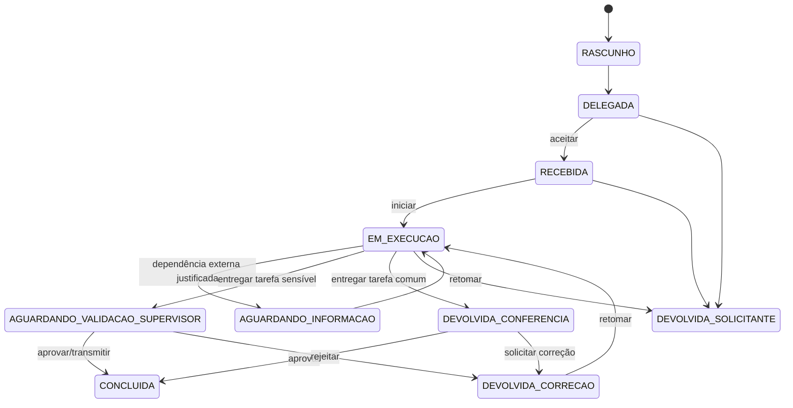
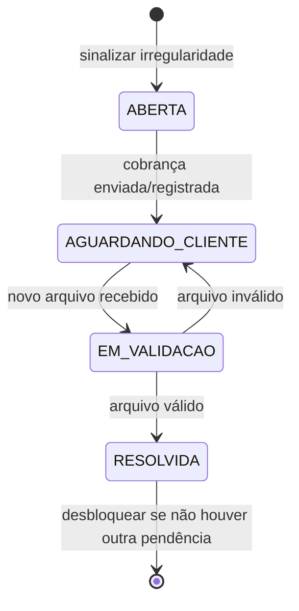
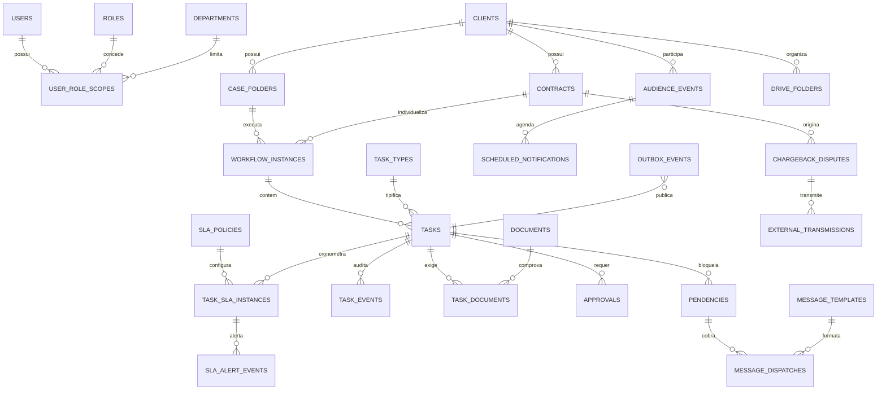
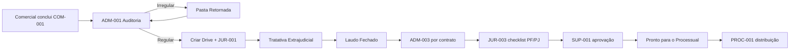
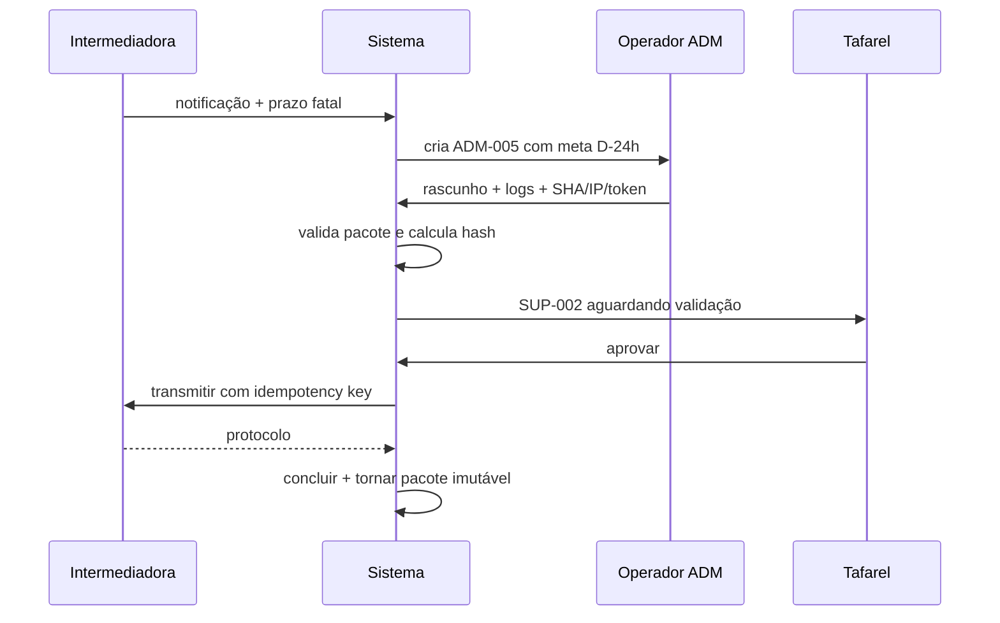
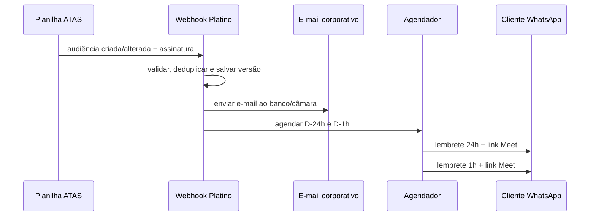

# Especificação Técnica — Workflow Operacional Platino

**Organização:** Platino Soluções Financeiras LTDA  
**Versão:** 1.0  
**Finalidade:** base lógica para banco de dados, APIs, automações, telas, permissões e testes do sistema proprietário de tarefas.  
**Fuso oficial:** `America/Sao_Paulo`  
**Princípio de auditoria:** nenhuma alteração operacional relevante pode existir sem autor, data/hora, estado anterior, estado posterior e justificativa/evidência quando aplicável.

## 0. Decisões arquiteturais

1. **Cliente, contrato, pasta/tratativa e tarefa são entidades diferentes.** Um cliente pode ter vários contratos; cada contrato pode originar tratativas e tarefas independentes.
2. **Estado da pasta não é estado da tarefa.** A pasta representa a fase global do atendimento. A tarefa representa uma unidade executável com responsável, SLA e evidência.
3. **Status não é texto livre.** Mudanças ocorrem exclusivamente por comandos de domínio validados no back-end.
4. **Permissão combina papel e escopo.** Exemplo: um supervisor jurídico pode aprovar tarefas jurídicas, mas não transmitir chargeback se a política exigir Tafarel.
5. **Conclusão exige evidência proporcional ao tipo de tarefa.** Tarefas documentais exigem arquivos e metadados; tarefas de contato podem exigir registro da interação, data, canal e resultado.
6. **Integrações são assíncronas e idempotentes.** Drive, CRM, e-mail, Ástrea e contabilidade usam fila/outbox com chave de idempotência.
7. **SLA fatal nunca é apagado ou reiniciado.** Esperas podem pausar apenas o SLA operacional quando a regra do tipo permitir; o prazo legal/externo permanece correndo.

### 0.1 Premissas configuráveis

- “SLA curto” foi normalizado inicialmente para **4 horas úteis**.
- Jornada padrão sugerida: segunda a sexta, 08:00–18:00, exceto feriados cadastrados.
- Chargeback trabalha com prazo fatal recebido da intermediadora e meta interna de conclusão em `prazo_fatal - 24h`.
- Os nomes de pessoas são exemplos de alocação; autorização deve usar `user_id`, papel e departamento, nunca comparação textual de nome.

## 1. Arquitetura de perfis e permissões (RBAC + escopo)

### 1.1 Modelo de autorização

```text
Permissão efetiva = papel + departamento/escopo + vínculo com a tarefa + etapa + política de aprovação
```

Papéis canônicos:

| Código | Papel | Escopo principal |
|---|---|---|
| `COMERCIAL_OPERADOR` | Comercial | Contratos e disparo do onboarding |
| `ADMIN_OPERADOR` | Administrativo | Auditoria, GOV, laudos, termos, notificações, audiências e chargeback em rascunho |
| `JURIDICO_OPERADOR` | Jurídico | Documentos iniciais/judiciais, vínculo, negociação e laudos |
| `PROCESSUAL_ADVOGADO` | Processual/Advogado | Distribuição, movimentações, custas, decisões e recursos |
| `SUPERVISOR_ADMIN` | Tafarel | Administração, chargeback, envios externos e auditoria crítica |
| `SUPERVISOR_JURIDICO` | Nicolas | Jurídico, conferência jurídica e liberação ao Processual |
| `AUDITOR_SOMENTE_LEITURA` | Auditoria | Consulta integral sem comandos mutáveis |
| `SERVICE_INTEGRATION` | Integrações | Comandos técnicos restritos e assinados |

Usuários iniciais por alocação:

| Departamento | Usuários | Papel base |
|---|---|---|
| Comercial | equipe comercial | `COMERCIAL_OPERADOR` |
| Administrativo | Yasmin, Thayla | `ADMIN_OPERADOR` |
| Jurídico | Nicole, Tabata, Elaine, Janaina | `JURIDICO_OPERADOR` |
| Processual | Matheus | `PROCESSUAL_ADVOGADO` |
| Supervisão | Tafarel, Nicolas | papéis de supervisão conforme escopo |

### 1.2 Matriz de capacidades

Legenda: `P` permitido; `E` permitido somente no próprio escopo/vínculo; `A` exige aprovação; `—` proibido.

| Capacidade | Comercial | Administrativo | Jurídico | Processual | Sup. Tafarel | Sup. Nicolas |
|---|---:|---:|---:|---:|---:|---:|
| Consultar cliente e contratos necessários | E | E | E | E | P | P |
| Criar contrato/onboarding | P | — | — | — | P | — |
| Criar/delegar tarefa | E | E | E | E | P | P |
| Aceitar/iniciar tarefa própria | E | E | E | E | E | E |
| Registrar pendência/espera | E | E | E | E | P | P |
| Devolver ao solicitante | E | E | E | E | P | P |
| Entregar para conferência | E | E | E | E | E | E |
| Concluir tarefa própria simples | E | E | E | E | P | P |
| Aprovar tarefa de subordinado | — | — | — | — | P | P no Jurídico |
| Aprovar chargeback | — | — | — | — | P | somente parecer jurídico |
| Transmitir chargeback/e-mail externo sensível | — | — | — | — | P | —, salvo delegação formal |
| Liberar “Pronto para o Processual” | — | — | A | — | P | P |
| Protocolar/distribuir ação | — | — | — | P | consulta | consulta |
| Alterar SLA fatal | — | — | — | — | P com justificativa | P no escopo jurídico |
| Excluir tarefa/evento/documento | — | — | — | — | não excluir; cancelar/arquivar | não excluir; cancelar/arquivar |
| Ver auditoria completa | — | E | E | E | P | P |

### 1.3 Regras de segregação de funções

- Quem redige uma defesa de chargeback não pode transmiti-la.
- Quem anexa documento judicial pode marcar conferência, mas não alterar o binário original.
- A liberação externa deve registrar aprovador diferente do operador quando a política do tipo exigir dupla checagem.
- Supervisor executando tarefa própria pode concluí-la, mas o sistema registra `self_completed=true`; tarefas de alto risco ainda exigem segundo aprovador.
- A IA pode classificar e sugerir; não pode aceitar evidência, aprovar, transmitir, excluir ou alterar prazo.

### 1.4 Aplicação técnica

- JWT contém somente identidade; papéis e escopos são lidos do banco.
- RLS restringe leitura por departamento, vínculo, solicitante ou supervisão.
- Escritas ocorrem via RPC/commands `SECURITY DEFINER` com validação interna, nunca por `UPDATE status` direto.
- Toda permissão sensível deve ser repetida no back-end; ocultar botão é apenas proteção de interface.

## 2. Dicionário de tarefas (Task Dictionary)

### 2.1 Campos obrigatórios de qualquer tipo de tarefa

`task_type_code`, cliente, contrato quando aplicável, tratativa, departamento de origem/destino, solicitante, responsável, título, solicitação, resultado esperado, prioridade, SLA, prazo fatal, critérios de conclusão, política de aprovação e destino documental.

### 2.2 Tarefas essenciais

| ID canônico | Tarefa | Responsável | Gatilho | SLA/meta interna | Evidências obrigatórias | Saída/guard de conclusão |
|---|---|---|---|---|---|---|
| `COM-001` | Registrar contrato assinado | Comercial | Venda concluída | imediato; até 1h útil | contrato completo; envelope/registro de assinatura; ID do contrato | cria/vincula cliente e contrato; dispara `ADM-001` |
| `ADM-001` | Analisar contrato e organizar pasta inicial | Administrativo | `COM-001` concluída | **24h corridas** | contrato assinado; validação de assinaturas; checklist de dados; registro de divergências | regular cria árvore Drive e onboarding; irregular força Pasta Retornada |
| `JUR-001` | Coletar e conferir 5 documentos iniciais | Jurídico | `ADM-001` regular | 24h para solicitar; espera externa controlada | identificação; CPF; comprovante de endereço; contrato; documento financeiro definido | checklist completo ou pendência tipificada; comprovante >60 dias bloqueia |
| `ADM-002` | Executar requerimento de taxas no GOV.BR | Administrativo | solicitação jurídica válida | **4h úteis** configuráveis | solicitação; identificação/credencial de canal; comprovante/protocolo GOV | protocolo individual anexado em `04`; evento de envio |
| `ADM-003` | Solicitar laudo pericial à contabilidade | Administrativo | CRM = Laudo Fechado | 2h úteis para solicitar; retorno externo conforme fornecedor | contrato específico; demonstrativos; identificação; formulário contábil | uma tarefa e um protocolo por `contract_id`; nunca agrupar contratos |
| `JUR-002` | Negociar proposta extrajudicial | Jurídico | documentação inicial apta | SLA por estratégia; revisão diária | histórico de contatos; propostas; aceite/recusa | resultado tipificado e próxima ação; pode gerar audiência ou laudo |
| `ADM-004` | Agendar audiência de conciliação extrajudicial | Administrativo | decisão jurídica de audiência | 8h úteis para envio; confirmação em 24h | dados das partes; planilha de controle; minuta/e-mail; comprovante de envio | e-mail enviado à Câmara Exímia + protocolo + evento de calendário |
| `JUR-003` | Solicitar e conferir documentos para esfera judicial | Jurídico | decisão de judicialização | 24h para solicitar; pendência externa pausável | checklist PF ou PJ, jamais ambos implicitamente | checklist do tipo de parte completo; libera revisão supervisora |
| `SUP-001` | Liberar pasta ao Processual | Nicolas/Tafarel conforme escopo | `JUR-003` entregue | 4h úteis | checklist judicial; laudos; procurações; isenções; integridade dos arquivos | altera pasta para Pronto para o Processual e cria `PROC-001` |
| `ADM-005` | Preparar defesa de chargeback | Administrativo | notificação UoPay/PayUp | prazo dinâmico; pronto **D-24h** | notificação; contrato; Clicksign audit log; SHA-256; IP; token; comprovantes | salva rascunho e cria `SUP-002`; operador não transmite |
| `SUP-002` | Validar e transmitir chargeback | Tafarel | `ADM-005` entregue | 4h ou antes de D-6h, o que ocorrer primeiro | pacote completo; parecer; hash do pacote; aprovação | transmissão real, protocolo e horário; torna pacote imutável |
| `PROC-001` | Distribuir ação no fórum | Processual/Matheus | pasta = Pronto para o Processual | 1 dia útil ou prazo legal menor | petição; procuração; documentos; laudo; guia quando aplicável | número do processo e protocolo; pasta = Protocolado/Distribuído |
| `PROC-002` | Ler e classificar movimentação Ástrea/Aetrea | Processual | webhook/polling de nova movimentação | 4h úteis; urgente conforme prazo judicial | conteúdo original da movimentação; origem e horário da captura | classificação, prazo judicial e tarefa derivada |
| `PROC-003` | Emitir guia de custas | Processual | ordem judicial ou requisito de protocolo | prazo judicial - margem interna | guia original; memória de cálculo; tribunal | guia registrada e tarefa de pagamento quando aplicável |
| `PROC-004` | Analisar sentença e providência recursal | Processual + supervisão jurídica | sentença capturada | 1 dia útil ou prazo legal - margem | sentença original; intimação; cálculo do prazo; parecer | encerra ou altera pasta para Fase Recursal; cria tarefas do recurso |

### 2.3 Checklists PF e PJ de `JUR-003`

| Pessoa Física | Pessoa Jurídica/CNPJ |
|---|---|
| RG ou CNH | cartão CNPJ atualizado |
| CPF | contrato/estatuto social e alterações |
| comprovante de endereço ≤60 dias | documento do representante legal |
| procuração PF | prova de poderes de representação |
| declaração de hipossuficiência/isenção quando aplicável | procuração PJ |
| documentos financeiros/contratuais do caso | comprovante de endereço da sede ≤60 dias |

Regra XOR: `party_type` deve ser `PF` ou `PJ`. O checklist ativo é derivado desse campo; não é permitido marcar genericamente “documentos completos”.

### 2.4 Política de SLA

- `due_at`: prazo operacional calculado.
- `fatal_due_at`: prazo legal/externo imutável.
- `internal_target_at`: margem de segurança anterior ao prazo fatal.
- `waiting_started_at`/`waiting_seconds`: pausa permitida somente para dependência externa tipificada.
- Não pausar: chargeback, prazo judicial, audiência já marcada e qualquer prazo explicitamente fatal.
- Escalonamento padrão: `<50%` verde; `50%` amarelo; `75%` vermelho e líder; `90%` reforço crítico; `100%` estouro e supervisor.

### 2.5 Motor regressivo anti-esquecimento

O relógio é criado na mesma transação que cria a tarefa. O monitor deve processar tarefas abertas pelo menos uma vez por minuto e também recalcular o nível quando receber um evento relevante. Reiniciar worker, navegador ou sessão não altera o prazo.



| Nível | Regra padrão | Interface | Destinatários | Frequência |
|---|---|---|---|---|
| `GREEN` | consumo `<50%` | contador verde e prazo exato | responsável | evento inicial único |
| `YELLOW` | consumo `>=50% e <75%` | cartão amarelo; ordenação elevada | responsável | uma vez na entrada |
| `RED` | consumo `>=75% e <100%` | cartão vermelho, destaque persistente | responsável + líder do departamento | entrada e lembrete configurável |
| `BREACHED` | `now >= effective_due_at` | vermelho crítico; fila de urgência | responsável + Tafarel/Nicolas conforme escopo | entrada + escalonamento periódico sem duplicação |

Fórmula para prazo corrido:

```text
elapsed_ratio = max(0, now - started_at) / (effective_due_at - started_at)
effective_due_at = due_at + paused_duration_permitted
```

O evento de mudança de nível usa chave única `(task_id, sla_instance_id, alert_level)`. Assim, retries não enviam alertas duplicados.

#### 2.5.1 Catálogo inicial de SLAs

| Código | Tarefa operacional | Gatilho/`started_at` | SLA inicial | Calendário | Ação determinística no estouro |
|---|---|---|---:|---|---|
| `T01` | Saneamento de Pasta Retornada | Processual marca Pasta Retornada | 24h | corridas | prioridade crítica, fila de urgência e alerta Tafarel |
| `T02` | Resposta de Defesa de Chargeback | notificação registrada | 72h | corridas/fatal | bloqueia o workspace da tarefa até salvar rascunho; alerta Tafarel |
| `T03` | Acompanhamento de Protocolo GOV | protocolo Consumidor.gov emitido | 5 dias | corridos, configurável | cria subtarefa idempotente “Verificar Retorno do Banco” |
| `T04` | Liberação de Laudo Contábil | CRM alterado para Laudo Fechado | 48h | corridas | envia alerta auditável à contabilidade parceira e supervisor |
| `T05` | Monitoramento de Certidão TJSP | pedido cadastrado no portal TJSP | 5 dias | corridos, configurável | cria alerta/tarefa para baixar e registrar o PDF |

Regras adicionais:

- `T02` é prazo fatal e não aceita pausa. Seu vencimento efetivo é o menor valor entre `created_at + 72h` e o prazo da intermediadora; a meta D-24h continua valendo quando for anterior. O bloqueio é restrito ao workspace da tarefa vencida: o operador ainda pode acessar ajuda, comunicação e sair do sistema.
- `T03` e `T05` não criam nova subtarefa se já existir uma aberta para o mesmo protocolo/pedido e ciclo.
- `T04` registra entrega do alerta (`sent`, `delivered`, `failed`); falha técnica gera retry, não conclusão fictícia.
- Mudança manual de prazo exige supervisor, justificativa, prazo anterior/novo e evento de auditoria.
- Conclusão após o vencimento não apaga o estouro; grava `completed_late=true` e duração do atraso.

## 3. Máquinas de estado

## 3.1 Estado da pasta/atendimento



| Estado | Significado | Entrada obrigatória | Ações permitidas | Saída |
|---|---|---|---|---|
| `PENDENTE_ANALISE` | contrato recebido aguardando auditoria | contrato assinado e cliente identificado | analisar, apontar divergência, criar pasta | regular → Extrajudicial; irregular → Retornada |
| `TRATATIVA_EXTRAJUDICIAL` | atendimento e negociação ativos | contrato regular e pasta mínima | documentos, GOV, proposta, audiência, laudo | Laudo Fechado ou Retornada |
| `LAUDO_FECHADO` | decisão técnica/negocial consolidada | status CRM com autor/data e contrato | laudo contábil, documentos judiciais | Pronto Processual ou Retornada |
| `PASTA_RETORNADA` | gargalo formal por pendência | código de motivo, responsável e prazo | sanar, cobrar, anexar substituto | retorna ao estado anterior guardado |
| `PRONTO_PROCESSUAL` | pacote judicial aprovado | checklist PF/PJ e aprovação supervisor | somente leitura documental; distribuição | Protocolado/Distribuído |
| `PROTOCOLADO_DISTRIBUIDO` | ação distribuída | tribunal, protocolo e número do processo | movimentações, custas, prazos, sentença | Fase Recursal ou encerramento |
| `FASE_RECURSAL` | decisão de recorrer | sentença/intimação e prazo calculado | preparar/protocolar recurso, acompanhar | encerramento |

`PASTA_RETORNADA` exige `return_reason_code`, `return_details`, `returned_by`, `returned_at`, `owner_department`, `correction_due_at` e `previous_folder_status`.

### 3.2 Estado da tarefa



Estados terminais: `CONCLUIDA`, `CANCELADA`, `ARQUIVADA`. Atraso é situação de SLA, não status.

### 3.3 Comandos e guards

| Comando | De → Para | Quem | Guards mínimos |
|---|---|---|---|
| `delegate_task` | Rascunho → Delegada | solicitante/supervisor | campos, responsável ativo, prazo futuro |
| `accept_task` | Delegada → Recebida | executor | vínculo com tarefa |
| `start_task` | Recebida/Correção → Em execução | executor | aceite existente |
| `wait_external` | Em execução → Aguardando informação | executor | motivo, terceiro responsável, previsão; tipo permite pausa |
| `resume_task` | Aguardando → Em execução | executor | resolução registrada |
| `submit_for_review` | Em execução → Conferência/Validação | executor | checklist e evidências completas |
| `approve_task` | Conferência → Concluída | supervisor/solicitante autorizado | política de aprovação e integridade |
| `transmit_external` | Validação → Concluída | Tafarel | aprovação vigente, prazo, hash e idempotência |
| `return_for_correction` | Conferência/Validação → Correção | aprovador | motivo ≥10 caracteres |
| `complete_own_task` | estado aberto → Concluída | responsável supervisor | tarefa própria e tipo sem dupla aprovação |
| `cancel_task` | estado não terminal → Cancelada | supervisor | justificativa e ausência de transmissão irreversível |

## 4. Segurança máxima e travas operacionais

| Regra | Validação determinística | Comportamento de bloqueio | Registro obrigatório |
|---|---|---|---|
| `VAL-ADDR-060` | `current_date - issue_date > 60` | impede avanço; pasta → Retornada; cria tarefa de nova via SLA 4h | documento, data, cálculo e autor |
| `VAL-MULTI-CONTRACT` | cliente possui `count(active_contracts) > 1` | proíbe solicitação unificada de laudo; exige uma `ADM-003` por contrato | IDs de contrato e tentativas bloqueadas |
| `VAL-CHARGEBACK-APPROVAL` | operador tenta transmitir sem aprovação | comando indisponível na UI e negado no back-end | operador, pacote, aprovador e decisão |
| `VAL-EXTERNAL-MAIL` | e-mail classificado como sensível | cria Validação Supervisor; não envia | conteúdo versionado, destinatários e hash |
| `VAL-PUBLIC-DOC-IMMUTABLE` | arquivo pertence às pastas 04, 07 ou 09 | proíbe edição, overwrite e conversão destrutiva | Drive file ID, versão, SHA-256 e origem |
| `VAL-PF-PJ-XOR` | tipo da parte ausente/ambíguo | não habilita checklist judicial | tipo escolhido e autor |
| `VAL-FATAL-DEADLINE` | prazo calculado ausente ou no passado | não delega; incidente se integração enviar prazo inválido | payload original e cálculo |
| `VAL-DUPLICATE-EVENT` | mesma chave de idempotência | retorna resultado anterior; não duplica tarefa/envio | idempotency key |
| `VAL-CONCURRENT-UPDATE` | `version` divergente | HTTP 409; força recarga | versão esperada e atual |
| `VAL-HASH-MISMATCH` | hash atual difere do aprovado | invalida aprovação e volta para validação | hashes anterior/atual |

### 4.1 Endereço com mais de 60 dias

```text
Ao anexar: extrair/informar issue_date → validar formato e futuro → calcular idade.
Se idade > 60:
  1. documento = REJEITADO_EXPIRADO;
  2. pasta = PASTA_RETORNADA;
  3. criar pendência DOC_ENDERECO_EXPIRADO;
  4. criar tarefa “Solicitar nova via” com SLA 4h;
  5. notificar executor, supervisor e solicitante;
  6. impedir PRONTO_PROCESSUAL enquanto não houver documento válido.
```

### 4.2 Contratos múltiplos

- Chave única: `(task_type_code='ADM-003', contract_id, workflow_cycle)`.
- Cada tarefa possui seus próprios anexos, destinatário, protocolo e status.
- O e-mail à contabilidade usa assunto com `client_code + contract_code`.
- Uma conclusão não altera a outra. A pasta só avança se a política exigir e todas as tarefas necessárias estiverem concluídas.

### 4.3 Chargeback e transmissões externas

- Operador pode `save_draft` e `submit_for_supervisor`.
- O endpoint de transmissão exige papel `SUPERVISOR_ADMIN`, aprovação não expirada e hash igual ao aprovado.
- Aprovação é invalidada por qualquer alteração em conteúdo, destinatário ou anexo.
- Transmissão usa idempotency key `chargeback:{dispute_id}:{package_version}`.
- Guardar request, response, protocolo, horário, usuário e comprovante na pasta 04 ou 06 conforme natureza.

### 4.4 Imutabilidade documental

- “Imutável” significa sem edição/overwrite pela aplicação; correção cria nova versão e preserva a anterior.
- Metadados: `drive_file_id`, `folder_code`, `mime_type`, `size`, `sha256`, `source`, `uploaded_by`, `uploaded_at`, `version`, `supersedes_document_id`, `immutable=true`.
- Download pode ser permitido por escopo; exportação e compartilhamento devem ser auditados.
- A aplicação não oferece editor de PDF para pastas 04, 07 e 09.

### 4.5 Esteira rígida de pendências

Na interface, o estado canônico `PASTA_RETORNADA` com subestado `PENDENCIA_CLIENTE` deve ser apresentado como **“Retida no Administrativo — Pendência Cliente”**. Isso preserva a máquina principal sem perder o rótulo operacional solicitado.



#### 4.5.1 Catálogo inicial de motivos

| Código | Motivo | Evidência da irregularidade | Ação corretiva automática |
|---|---|---|---|
| `ENDERECO_VENCIDO` | comprovante emitido há mais de 60 dias | documento + `issue_date` + cálculo | tarefa “Solicitar comprovante atualizado”, prioridade alta |
| `DOCUMENTO_ILEGIVEL` | imagem/PDF sem legibilidade suficiente | documento rejeitado + comentário | tarefa “Solicitar nova cópia legível” |
| `ULTIMA_PARCELA_AUSENTE` | ausência do comprovante da última parcela paga | checklist contratual | tarefa “Solicitar última parcela paga” |
| `ASSINATURA_DIVERGENTE` | assinatura não corresponde ao titular/representante | contrato e documento comparado | tarefa “Regularizar assinatura”, revisão supervisor quando crítica |
| `DOCUMENTO_AUSENTE` | requisito obrigatório não anexado | requirement code | tarefa de coleta específica |
| `DIVERGENCIA_CADASTRAL` | CRM, contrato e documento não coincidem | campos divergentes | tarefa de saneamento cadastral |
| `OUTRO_VALIDADO` | exceção classificada | justificativa ≥20 caracteres | tarefa definida pelo operador e registrada |

#### 4.5.2 Comando `signal_irregularity`

Entrada obrigatória: `task_id`, `folder_id`, `reason_code`, `details`, `document_id` quando houver, responsável corretivo e prazo. Em uma única transação o back-end deve:

1. criar a pendência com status `ABERTA`;
2. manter `previous_folder_status` e alterar a pasta para `PASTA_RETORNADA/PENDENCIA_CLIENTE`;
3. criar tarefa corretiva vinculada por `parent_task_id` e `pendency_id`, prioridade alta;
4. aplicar bloqueio `PROCESSUAL_ADVANCE` na pasta;
5. gerar evento append-only e notificar responsável/supervisor;
6. disponibilizar a cobrança apropriada na Central de Comunicação.

#### 4.5.3 Desbloqueio

- Anexar novo arquivo muda a pendência para `EM_VALIDACAO`, mas não desbloqueia a pasta.
- Um operador autorizado valida o novo arquivo contra a mesma regra que originou o bloqueio.
- Se inválido, o arquivo é rejeitado, a pendência volta a `AGUARDANDO_CLIENTE` e uma nova cobrança pode ser enviada.
- Se válido, a pendência é `RESOLVIDA` com `resolution_document_id`, validador e horário.
- A pasta só retorna a `previous_folder_status` quando `count(open_blocking_pendencies)=0`.
- É proibido encerrar manualmente a tarefa corretiva sem resolver a pendência vinculada.

#### 4.5.4 Alerta de inércia

Uma pasta gera `PENDENCY_INERTIA` quando permanece retida por mais de 48h e não existe comunicação `SENT` ou `DELIVERED` posterior à abertura da pendência. O alerta amarelo desaparece somente após comunicação registrada ou resolução; apenas abrir a tela não conta como ação.

## 5. Taxonomia e backup de arquivos — Google Drive

### 5.1 Estrutura padrão por cliente

```text
[ANO] - [NOME CLIENTE] - [CLIENT_CODE]
├── 01_CONTRATO_E_ASSINATURAS
├── 02_DOCUMENTOS_CLIENTE
├── 03_TRATATIVA_EXTRAJUDICIAL
├── 04_GOV_E_PROTOCOLOS_ADMINISTRATIVOS
├── 05_LAUDOS_E_CONTABILIDADE
├── 06_NOTIFICACOES_E_AUDIENCIAS
├── 07_DOCUMENTOS_JUDICIAIS
├── 08_PROCESSO_CUSTAS_E_PROTOCOLOS
├── 09_DECISOES_SENTENCAS_E_RECURSOS
└── 10_ARQUIVO_COMPLEMENTAR
```

### 5.2 Mapeamento tarefa → pasta

| Pasta | Conteúdo | IDs de tarefa produtores | Política |
|---|---|---|---|
| `01` | contratos, aditivos, Clicksign e assinaturas | `COM-001`, `ADM-001`, `ADM-005` (provas contratuais) | versionado; assinatura original imutável |
| `02` | documentos PF/PJ e comprovantes | `JUR-001`, `JUR-003` | endereço com metadado de emissão |
| `03` | contatos, propostas e tratativas | `JUR-002` | histórico cronológico; sem sobrescrever |
| `04` | GOV, protocolos administrativos e transmissões | `ADM-002`, `ADM-005`, `SUP-002`, `T02`, `T03` | **imutável**; hash obrigatório |
| `05` | pedidos e laudos da contabilidade | `ADM-003`, `T04` | subpasta lógica por `contract_code` |
| `06` | notificações e audiências extrajudiciais | `ADM-004` | guardar enviado, recibo e confirmação |
| `07` | procurações, isenções e documentos judiciais | `JUR-003`, `SUP-001` | **imutável**; PF/PJ classificado |
| `08` | petições, distribuição, protocolos e custas | `PROC-001`, `PROC-003` | protocolo e guia com origem |
| `09` | movimentações, decisões, sentenças e recursos | `PROC-002`, `PROC-004`, `T05` | **imutável** para originais públicos |
| `10` | material complementar não classificado | qualquer, mediante justificativa | uso excepcional; exige categoria |

### 5.3 Fluxo de integração

1. Contrato validado gera evento `client.folder.requested`.
2. Worker cria/reencontra a pasta por `client_code` e salva `drive_root_folder_id`.
3. Worker cria as 10 subpastas com chave idempotente `(client_id, folder_code)`.
4. Conclusão da tarefa emite `document.route.requested` para cada evidência.
5. Worker copia/move o arquivo, lê metadados, calcula SHA-256 e grava `document_id`.
6. Somente após confirmação do Drive a evidência fica `STORED`.
7. Falha gera retry exponencial; após limite vai para dead-letter queue e alerta supervisor.

### 5.4 Arquivo morto e backup

- Cancelamento, distrato ou inadimplência >15 dias gera solicitação de arquivamento, não movimentação imediata.
- Guard: documentos finais, CRM, planilha e motivo completos.
- Mover raiz de `01_CLIENTES_ATIVOS` para `02_ARQUIVO_MORTO`, preservando `drive_root_folder_id`.
- Backup diário de metadados e eventos; verificação amostral de hashes; política de retenção conforme orientação jurídica/LGPD.

## 6. Modelo lógico de dados



### 6.1 Tabelas nucleares

| Tabela | Campos essenciais | Restrições principais |
|---|---|---|
| `users` | id UUID, auth_id, nome, email, active | email único normalizado |
| `departments` | id, code, name | code único |
| `roles` | id, code | code único |
| `user_role_scopes` | user_id, role_id, department_id, valid_from/to | não sobrepor concessões equivalentes |
| `clients` | id, code, nome, CPF/CNPJ, party_type, status | CPF/CNPJ parcial único conforme política |
| `contracts` | id, client_id, code, banco, número, valores, active | `(client_id, numero_contrato)` único |
| `case_folders` | id, client_id, status, previous_status, drive_root_id, version | transição por comando |
| `workflow_definitions` | id, code, version, active | definição publicada é imutável |
| `workflow_instances` | id, definition_id, client_id, contract_id, state | idempotency key do gatilho |
| `task_types` | code, dept, SLA, approval_policy, folder_code, checklist_schema | versionado |
| `tasks` | id, external_id, type, workflow, assignee, status, due_at, fatal_due_at, version | estado via RPC; responsável ativo |
| `sla_policies` | code T01–T05, duração, calendário, limites, breach_action | política publicada é versionada |
| `task_sla_instances` | task_id, policy_version, started_at, due_at, paused_seconds, level, breached_at | uma instância ativa por tarefa/política |
| `sla_alert_events` | sla_instance_id, level, recipients, channel, sent_at | único por instância/nível/destinatário |
| `task_events` | id, task_id, event_type, from/to, actor, payload, created_at | append-only |
| `documents` | id, client, contract, Drive IDs, hash, immutable, version | hash e Drive ID indexados |
| `task_documents` | task_id, document_id, requirement_code, validation_status | requisito único por versão |
| `pendencies` | id, task/folder, reason_code, owner, due_at, resolved_at | resolução não apaga registro |
| `pendency_reason_catalog` | code, label, blocking_scope, corrective_task_type, message_template | versionado |
| `approvals` | id, task_id, policy, package_hash, approver, decision, expires_at | uma aprovação vigente por versão |
| `chargeback_disputes` | id, contract_id, intermediadora, transação, fatal_due_at, status | contrato obrigatório |
| `external_transmissions` | id, subject_type/id, channel, idempotency_key, request/response, protocol | chave única |
| `message_templates` | id, code, channel, locale, body, variables, provider_template_id, version | somente versão aprovada pode enviar |
| `message_dispatches` | id, template_version, client, pendency, channel, destination_hash, provider_id, status | idempotency key e trilha de entrega |
| `audience_events` | id, client, source_row_id, starts_at, meet_url, status, version | Meet válido; origem ATAS única |
| `scheduled_notifications` | audience_id, offset, scheduled_at, status, dispatch_id | único por audiência/versão/offset/canal |
| `drive_folders` | client_id, folder_code, drive_folder_id | `(client_id, folder_code)` único |
| `outbox_events` | aggregate, event_type, payload, attempts, published_at | publicação transacional |

### 6.2 Enums recomendados

- `folder_status`: os sete estados definidos na seção 3.1, mais `ENCERRADO` e `ARQUIVO_MORTO`.
- `task_status`: estados da seção 3.2.
- `priority`: `BAIXA`, `NORMAL`, `ALTA`, `CRITICA`.
- `document_validation_status`: `PENDENTE`, `VALIDO`, `REJEITADO_EXPIRADO`, `REJEITADO_INTEGRIDADE`, `SUBSTITUIDO`.
- `approval_decision`: `PENDENTE`, `APROVADO`, `REJEITADO`, `EXPIRADO`, `INVALIDADO`.
- `pendency_reason`: endereço expirado, documento ausente, divergência cadastral, aguardo cliente, aguardo comercial, aguardo terceiro, erro crítico.
- `pendency_status`: `ABERTA`, `AGUARDANDO_CLIENTE`, `EM_VALIDACAO`, `RESOLVIDA`, `CANCELADA_COM_JUSTIFICATIVA`.
- `sla_level`: `GREEN`, `YELLOW`, `RED`, `BREACHED`, `COMPLETED_ON_TIME`, `COMPLETED_LATE`.
- `message_status`: `DRAFT`, `QUEUED`, `SENT`, `DELIVERED`, `READ`, `FAILED`, `CANCELLED`.
- `audience_status`: `SCHEDULED`, `RESCHEDULED`, `CANCELLED`, `HELD`, `NO_SHOW`.

## 7. Processos ponta a ponta

### 7.1 Onboarding até Processual



### 7.2 Chargeback



### 7.3 Central de comunicação integrada

#### 7.3.1 Princípios

- WhatsApp deve usar API oficial Meta/WhatsApp Business ou BSP homologado; automação por WhatsApp Web é proibida.
- Mensagens iniciadas pela empresa fora da janela permitida usam template previamente aprovado pelo provedor.
- E-mails saem de conta corporativa por integração server-side; operadores nunca recebem senha/token da caixa.
- Toda mensagem registra template e versão, variáveis renderizadas, solicitante, destinatário mascarado, provedor, horários e estados de entrega.
- O front-end solicita o envio; somente o back-end resolve o destinatário e chama o provedor.
- Consentimento, base legal, opt-out e política LGPD devem ser definidos antes de produção. Documentos sensíveis não são anexados ao WhatsApp por padrão.

Estados de uma comunicação: `DRAFT → QUEUED → SENT → DELIVERED → READ`, com saída alternativa `FAILED` ou `CANCELLED`.

#### 7.3.2 Cobrança de endereço vencido

O botão **Enviar cobrança via WhatsApp** aparece quando existe pendência aberta `ENDERECO_VENCIDO`, telefone válido e permissão de contato. Antes do envio, a interface mostra prévia somente leitura e pede confirmação.

Template lógico `WA_ENDERECO_VENCIDO_V1`:

> Olá, **{{cliente_nome}}**, tudo bem? Aqui é do setor Administrativo da Platino. Identificamos que o seu comprovante de endereço enviado possui mais de 60 dias de emissão e, por normas bancárias, precisamos de uma via atualizada para dar andamento ao seu processo. Por gentileza, nos envie uma foto nítida de uma conta recente de consumo (luz, água ou telefone) emitida nos últimos 60 dias. Obrigado!

Variáveis permitidas: somente `cliente_nome`. O template não aceita HTML, URL dinâmica ou texto livre. Chave de idempotência sugerida: `pendency:{pendency_id}:WA_ENDERECO_VENCIDO:{template_version}:{attempt_cycle}`.

Ao receber `SENT` ou `DELIVERED`, o sistema:

1. registra a comunicação na timeline do cliente e da pendência;
2. muda a pendência de `ABERTA` para `AGUARDANDO_CLIENTE`;
3. grava `last_collection_at` e responsável pela cobrança;
4. remove o alerta de inércia atual, sem resolver a pendência.

Falha de provedor não pode ser registrada como cobrança realizada.

#### 7.3.3 Audiência, planilha ATAS, e-mail e agenda

Fonte recomendada: Google Apps Script vinculado à planilha ATAS envia webhook assinado quando uma linha relevante é criada/alterada. Um reconciliador periódico compara `row_id + row_hash` para recuperar eventos perdidos.

Campos mínimos: `source_row_id`, cliente, e-mail/WhatsApp, banco/câmara, data/hora com fuso, `meet_url`, responsável e status. `meet_url` deve corresponder a `https://meet.google.com/[a-z0-9-]+`.



Regras:

- E-mail ao banco/câmara é imediato após validação e usa template por destinatário/tipo de audiência.
- Lembretes WhatsApp são agendados para `starts_at - 24h` e `starts_at - 1h` no fuso oficial.
- Se a audiência for criada a menos de 24h, o job vencido não é retrodisparado; envia-se apenas o próximo lembrete aplicável e registra-se a exceção.
- Reagendamento cancela jobs da versão anterior e cria novos. Cancelamento impede qualquer envio pendente.
- Cada envio é único por `(audience_id, audience_version, offset, channel)`.
- O link Meet é exibido somente ao cliente vinculado e aos usuários autorizados.
- Respostas/erros de entrega entram na timeline e geram alerta ao operador responsável.

## 8. APIs e comandos de domínio

| Método/rota sugerida | Comando | Observação |
|---|---|---|
| `POST /contracts/{id}/submit` | `submit_contract` | dispara onboarding idempotente |
| `POST /tasks` | `delegate_task` | cria e delega |
| `POST /tasks/{id}/accept` | `accept_task` | executor |
| `POST /tasks/{id}/start` | `start_task` | grava início |
| `POST /tasks/{id}/wait` | `wait_external` | motivo tipificado |
| `POST /tasks/{id}/submit-review` | `submit_for_review` | valida evidências |
| `POST /tasks/{id}/approve` | `approve_task` | aplica política |
| `POST /tasks/{id}/complete-own` | `complete_own_task` | supervisor responsável; baixo risco |
| `POST /tasks/{id}/return` | `return_for_correction` | justificativa |
| `POST /chargebacks/{id}/approve` | `approve_chargeback` | Tafarel |
| `POST /chargebacks/{id}/transmit` | `transmit_external` | servidor revalida hash |
| `POST /documents/register` | `register_drive_document` | metadados + hash |
| `POST /folders/{id}/transition` | `transition_folder` | guard por estado |
| `POST /tasks/{id}/irregularities` | `signal_irregularity` | cria pendência, tarefa corretiva e bloqueio |
| `POST /pendencies/{id}/submit-document` | `submit_pendency_document` | envia substituto para validação |
| `POST /pendencies/{id}/validate` | `validate_pendency_resolution` | resolve/rejeita e reavalia bloqueios |
| `POST /pendencies/{id}/messages/whatsapp` | `dispatch_pendency_message` | template aprovado e idempotente |
| `POST /integrations/atas/events` | `upsert_audience_event` | webhook assinado e versionado |
| `POST /audiences/{id}/email` | `dispatch_audience_email` | conta corporativa server-side |
| `POST /internal/sla/tick` | `evaluate_sla_batch` | worker autenticado; não exposto ao usuário |
| `GET /dashboards/supervisor` | consulta materializada | contadores com `as_of` e filtros |

Toda resposta mutável retorna `aggregate_id`, `new_status`, `version`, `event_id` e próximos comandos permitidos.

## 9. Notificações, painéis e métricas

### 9.1 Notificações

- nova tarefa; aceite pendente; 50/75/90/100% do SLA;
- documento rejeitado; pasta retornada; pendência há 24/48h;
- aguardando supervisor; correção solicitada; aprovação/conclusão;
- chargeback D-48h, D-24h, D-12h e D-6h;
- prazo judicial capturado/alterado.

Para alertas SLA, a notificação é orientada a evento. O worker persiste primeiro `sla_alert_event` e depois publica o envio pela outbox. Isso evita que uma falha do provedor perca ou duplique o alerta.

### 9.2 Dashboard Tafarel

| Indicador | Fórmula |
|---|---|
| Gargalo por operador | tarefas abertas por responsável, tipo e faixa de idade |
| Cumprimento de SLA | concluídas dentro do prazo / concluídas no período |
| Backlog vencido | tarefas abertas com `effective_due_at < now()` |
| Chargebacks críticos | disputas abertas com fatal <48h |
| Pasta Retornada | quantidade e tempo no estado; destaque >48h |
| First-pass yield | aprovadas sem correção / entregues para conferência |
| Retrabalho | número médio de ciclos de correção |
| Supervisor executor | tarefas próprias concluídas no prazo, com `self_completed=true` |

Métricas não devem incentivar baixa falsa. Uma tarefa só conta como concluída após os guards e evidências do tipo.

### 9.3 Quatro controles vivos prioritários

Atualização preferencial por eventos Postgres/stream; fallback de polling a cada 30 segundos. Toda resposta inclui `as_of`, e a UI mostra quando perdeu conexão em tempo real.

| Controle | Conteúdo e fórmula | Interação |
|---|---|---|
| **Painel de Gargalos** | `count(tasks abertas)` agrupado por Yasmin/Thayla e faixa `0–4h`, `4–12h`, `12–24h`, `>24h`; exibe também SLA consumido médio | clique aplica filtro por operadora e ordena pelo prazo mais próximo |
| **Fila de Validação de Chargeback** | `ADM-005/SUP-002` em `AGUARDANDO_VALIDACAO_SUPERVISOR`, com `fatal_due_at`, tempo restante, pacote e versão | Tafarel abre auditoria, aprova/rejeita e somente então transmite |
| **Alerta de Inércia** | pastas `PASTA_RETORNADA/PENDENCIA_CLIENTE` há `>48h` sem comunicação enviada após a pendência | amarelo pulsante acessível, sem depender apenas de cor; clique abre pendência e botão de cobrança |
| **Métrica de Saneamento** | semanal: pastas cuja pendência foi resolvida e que alcançaram `PRONTO_PROCESSUAL`; mostrar total, taxa e mediana do tempo de saneamento | gráfico por semana, operadora e motivo; drill-down auditável |

Fórmulas:

```text
gargalo_operador = tarefas não terminais atribuídas ao operador
chargeback_validation_queue = tarefas sensíveis aguardando aprovação vigente
inertia = now - pendency.opened_at > 48h AND max(message.sent_at) < pendency.opened_at
sanitation_success = count(distinct folder_id com pendência resolvida e transição posterior para PRONTO_PROCESSUAL)
sanitation_rate = sanitation_success / pastas com pendência aberta no período
```

Um mesmo cliente conta uma vez na métrica de pastas, mas cada tarefa continua aparecendo no backlog. Dados de produtividade devem permitir auditoria e não podem ser usados isoladamente para avaliação individual.

## 10. Requisitos não funcionais

- Disponibilidade alvo: 99,5% mensal.
- Auditoria append-only e retenção definida com Jurídico/LGPD.
- Criptografia TLS em trânsito e criptografia do provedor em repouso.
- Segredos exclusivamente no servidor/cofre; nunca no front-end ou comentários.
- Logs sem CPF, token GOV ou conteúdo documental sensível.
- MFA obrigatório para supervisores e contas de integração.
- Backup diário; teste trimestral de restauração.
- Índices para `tasks(assignee_id,status,due_at)`, contratos por cliente, eventos por agregado e documentos por Drive ID/hash.
- Comandos críticos com idempotência e optimistic locking (`version`).
- Acessibilidade WCAG 2.1 AA nos fluxos essenciais.
- Webhooks de WhatsApp, e-mail e ATAS exigem assinatura, timestamp e proteção contra replay.
- Telefones e e-mails são mascarados na interface quando não necessários; payloads de provedor têm retenção mínima.
- O motor de SLA deve recuperar alertas vencidos após indisponibilidade sem gerar duplicidade.
- O relógio usa data/hora do servidor e armazenamento UTC; apresentação e calendários usam `America/Sao_Paulo`.

## 11. Critérios mínimos de aceite

1. Dois contratos ativos do mesmo cliente geram duas tarefas `ADM-003`; tentativa unificada retorna erro de negócio.
2. Comprovante com 61 dias retorna a pasta e cria pendência; com 60 dias exatos é aceito.
3. Operador não visualiza nem consegue chamar a API de transmissão de chargeback.
4. Alterar um anexo após aprovação invalida a aprovação anterior.
5. Arquivo das pastas 04, 07 ou 09 não pode ser sobrescrito; nova versão preserva hash anterior.
6. Tarefa atrasada continua com status operacional e aparece no filtro de atraso.
7. Supervisor conclui tarefa própria simples, mas não contorna dupla aprovação em chargeback/envio externo.
8. Toda transição produz exatamente um evento, mesmo após retry de integração.
9. Falha do Drive não perde a conclusão: evento permanece na outbox e é reprocessado.
10. Checklist PJ não pode ser concluído com documentos de PF e vice-versa.
11. Tarefa `T01` entra em amarelo/vermelho/estourado uma única vez por nível e é escalada ao Tafarel após 24h.
12. Estouro de `T02` bloqueia a operação da tarefa até existir rascunho salvo, sem bloquear saída, ajuda ou comunicação.
13. `T03` e `T05` criam exatamente uma subtarefa por protocolo/pedido e ciclo, inclusive após retry do worker.
14. Sinalizar `ENDERECO_VENCIDO` altera a pasta, cria tarefa corretiva e bloqueia avanço ao Processual na mesma transação.
15. Anexar um arquivo não desbloqueia a pasta; somente validação positiva e ausência de outras pendências abertas desbloqueiam.
16. WhatsApp de endereço usa template aprovado, registra entrega e nunca marca cobrança em caso de falha do provedor.
17. Uma audiência gera e-mail imediato e lembretes únicos em D-24h e D-1h; reagendamento cancela jobs antigos.
18. Pasta retida há mais de 48h sem mensagem aparece no alerta de inércia; mera visualização não remove o alerta.
19. Dashboard separa contagem de Yasmin e Thayla e permite abrir exatamente as tarefas que compõem o número.
20. Métrica de saneamento conta somente pasta efetivamente liberada ao Processual após resolução validada.

## 12. Sequência recomendada de implementação

1. Normalizar identidades, departamentos, papéis e RLS.
2. Separar `case_folder_status` de `task_status` e bloquear updates diretos.
3. Criar catálogo versionado de tipos, checklists, SLA e políticas de aprovação.
4. Implementar commands e auditoria append-only.
5. Implementar validações de endereço, múltiplos contratos e PF/PJ.
6. Implementar outbox e Drive com as 10 pastas/idempotência.
7. Implementar chargeback com hash, aprovação e transmissão segregada.
8. Integrar CRM/Ástrea/Aetrea e captura de prazos.
9. Implementar motor de SLA T01–T05, outbox, scheduler e escalonamentos.
10. Implementar pendências rígidas e Central de Comunicação oficial.
11. Integrar ATAS/Agenda com versionamento e lembretes.
12. Construir os quatro controles vivos do dashboard e alertas.
13. Executar testes de segurança, concorrência, relógio, webhooks, restauração e aceite operacional.
